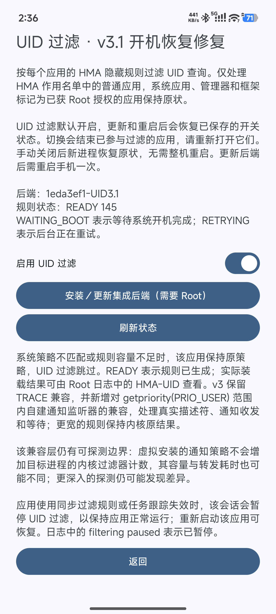
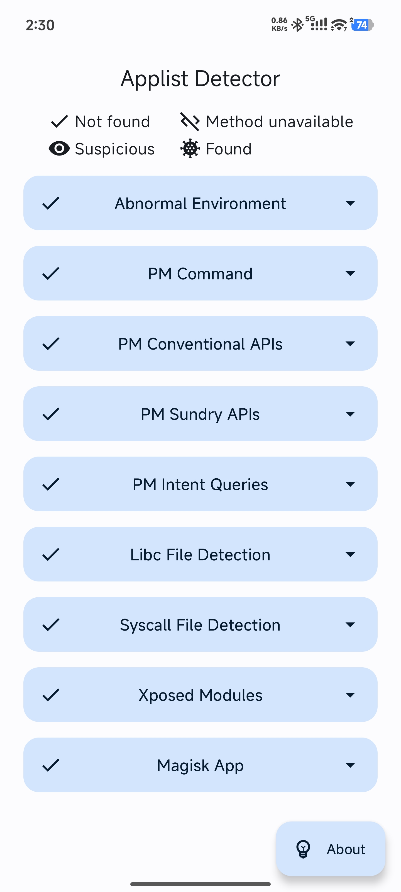
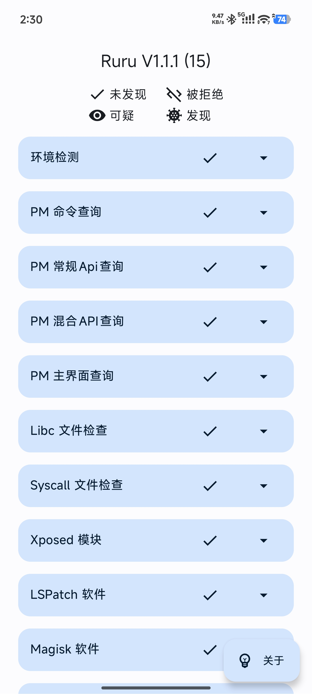
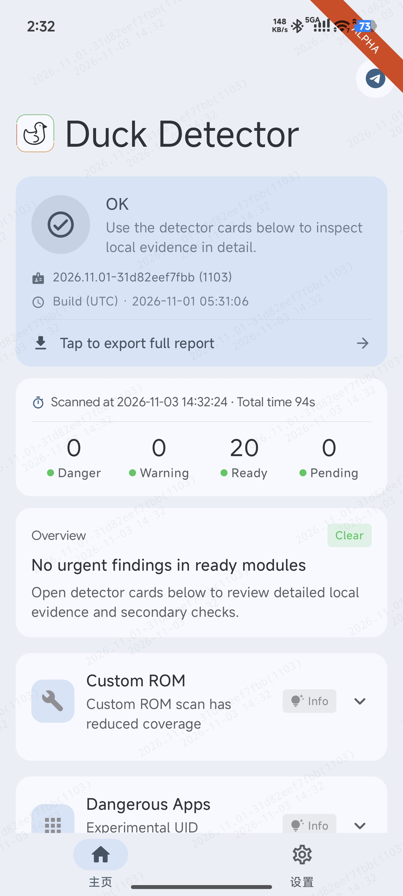
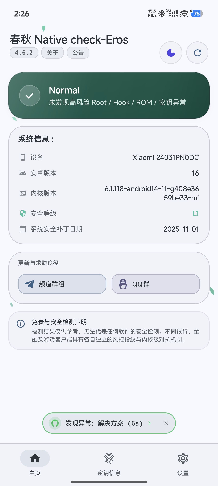
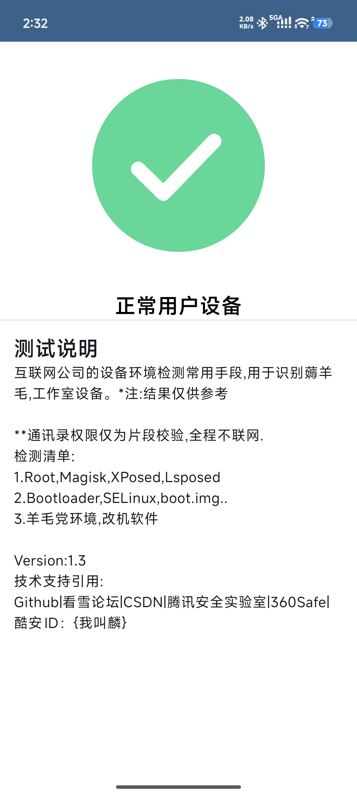
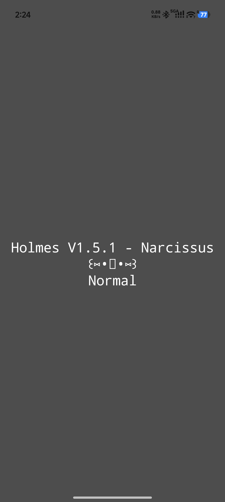
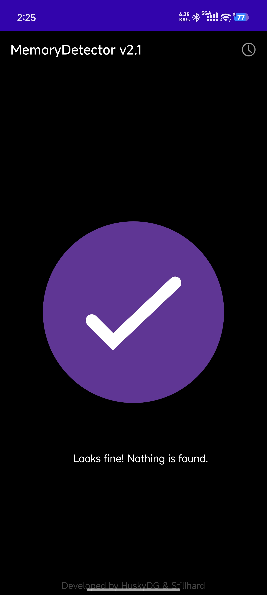
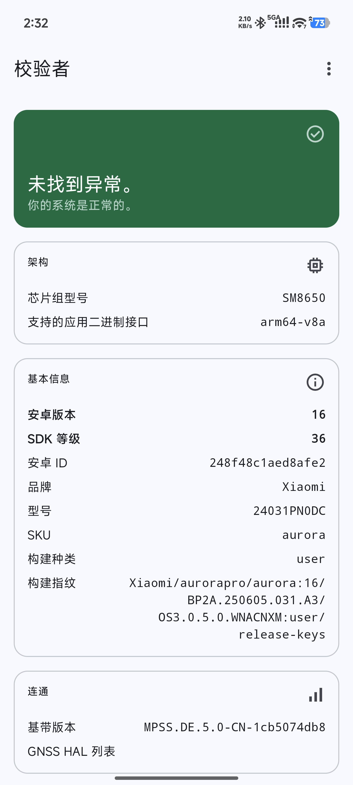
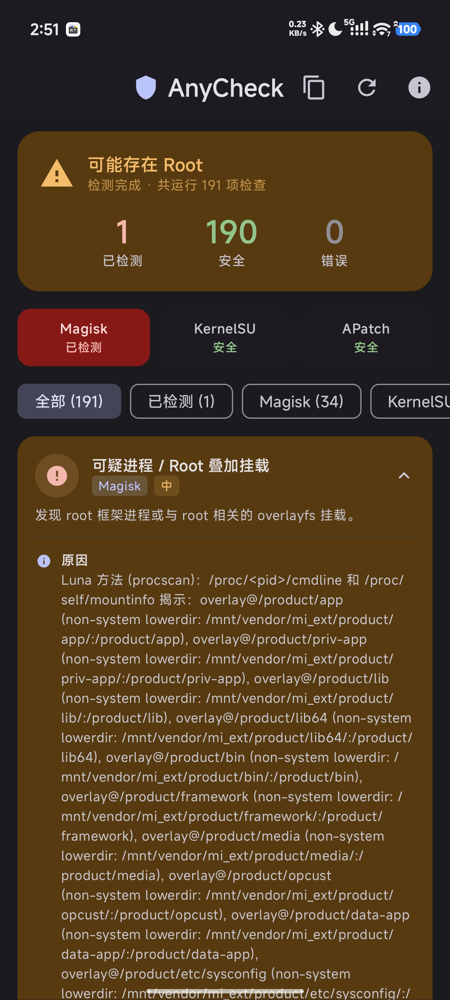

# HMA-OSS UID · 应用隐藏一体化增强版

在 HMA-OSS 中集成 UID 过滤，让应用列表隐藏和 UID 查询隐藏共同使用一套规则。选择作用应用、配置隐藏列表后，UID 过滤自动跟随，管理起来更直接。

基于版本：**1eda3ef1**。增强维护：[Moderate-Qi](https://github.com/Moderate-Qi)。

## 相比原版增加

- **UID 过滤自动跟随 HMA。** 根据每个作用应用的 HMA 规则生成配套 UID 策略。
- **完善 UID 查询隐藏。** 应用列表和相关 UID 查询一起管理，提升隐藏效果的一致性。
- **默认开启，独立开关。** 开关状态单独保存，重新打开相关应用即可应用调整。
- **开机自动恢复。** 系统就绪后恢复规则与开关状态，配合后台重试处理服务启动时序。
- **管理器与后端完整刷入包。** 在 SukiSU Ultra 中刷入 ZIP，一次完成配套更新，管理器和模块列表展示统一版本号。
- **管理器配置迁移。** 签名切换时备份原管理器配置，安装配套管理器后恢复配置，并提供恢复入口。

## 上游更新

当前底包为 `future-1eda3ef1`，继承上游 Android 10/11 部分 Hook 的统一处理、`checkUidPermission` 兼容改进，以及应用启动权限 Hook 的调整。上游的权限查询处理与集成的 UID 过滤一起保留，分别完善应用信息和 UID 查询的配套结果。

## 使用方式

1. 从本仓库 Releases 下载 `HMA-OSS-1eda3ef1-UID3.1-arm64.zip`，在 SukiSU Ultra 中刷入并重启。
2. 打开配套 HMA 管理器，按日常需求设置作用应用和隐藏列表。
3. 在“UID 过滤”页面查看开关与规则状态，`READY` 表示规则已生成。
4. 调整 UID 开关或规则后，重新打开相关作用应用。

## 实测环境

小米 14 Ultra，HyperOS 3.0.5.0，Android 16，SukiSU Ultra v4.3.0 / 41131-6（LKM），Zygisk Next 1.5.2（864），LSPosed 2.2.1（7912）。系统原始安全补丁日期为 2025-11-01。

## 界面与实测截图

### HMA UID 过滤：后端 1eda3ef1-UID3.1 与规则状态，READY 145表示对145个不同的软件应用了HMA隐藏以及UID过滤

### AppListDetector：应用列表查询结果

### Ruru 1.1.1：应用与环境查询结果

### Duck Detector 1103：20 Ready

### 春秋 4.6.2：Normal

### APT 检测 1.3：正常用户设备

### Holmes 1.5.1：Normal

### MemoryDetector 2.1：环境结果

### 校验者：系统状态正常

### AnyCheck：190 项安全，mi_ext 挂载被检测为AnyCheck的误报

## 来源、版权与许可证

上游项目：[future-1eda3ef1；frknkrc44、Kr328、Vladimir Kozelkov 及原项目贡献者](https://github.com/frknkrc44/HMA-OSS)。功能增强、集成和文档由 Moderate-Qi 维护，保留原作者署名与第三方版权记录。

[AGPL-3.0](LICENSE.md)，UID 与 Loader 组件分别保留 [Apache-2.0](uid-native/UID-LICENSE) 和 [MIT](uid-native/LOADER-LICENSE)。具体修改、来源和构建入口见 [CHANGELOG_LOCAL.md](CHANGELOG_LOCAL.md)、[NOTICE.md](NOTICE.md) 和 [BUILDING.md](BUILDING.md)。

## 配套项目

- [PIF 日期管理增强版](https://github.com/Moderate-Qi/PlayIntegrityFix-Dates)
- [TS-OSS 199 兼容增强版](https://github.com/Moderate-Qi/TrickyStoreOSS-Compat)
- [DuckUSB Service 服务增强版](https://github.com/Moderate-Qi/DuckUSB-Service)
- [TrickyAddon 目标管理增强版](https://github.com/Moderate-Qi/TrickyAddon-Targets)

## 免责声明

如有侵权请联系我删除。

仅代表本人使用的当前系统和当前环境下的实测结果，且通过相关检测器不代表所有软件都检测不到环境异常，请勿用于游戏作弊等场景。
